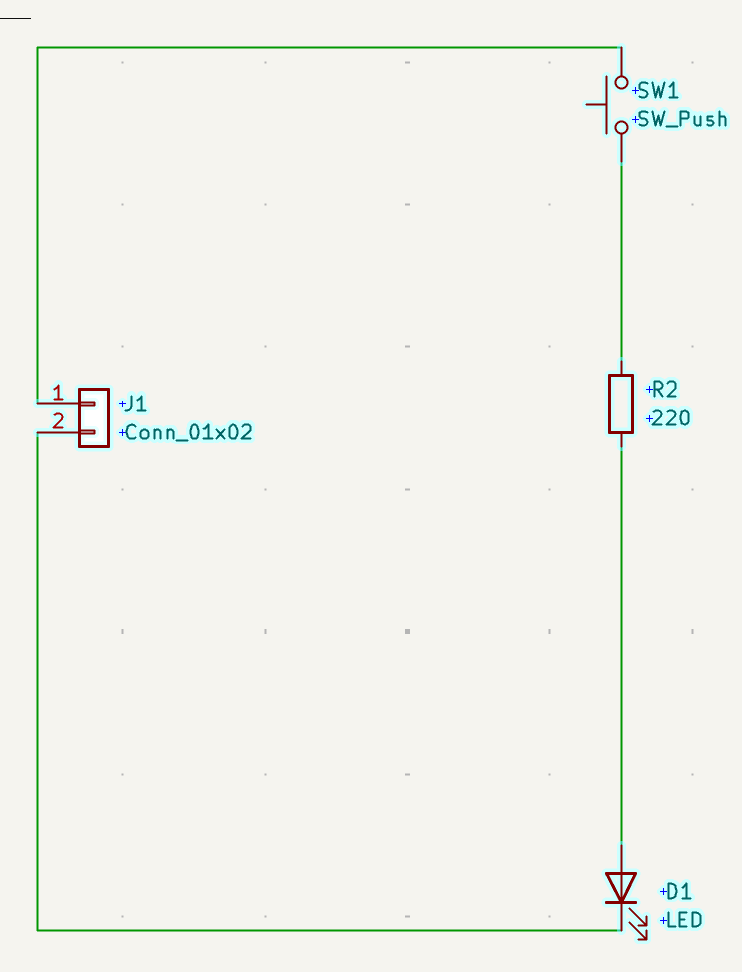
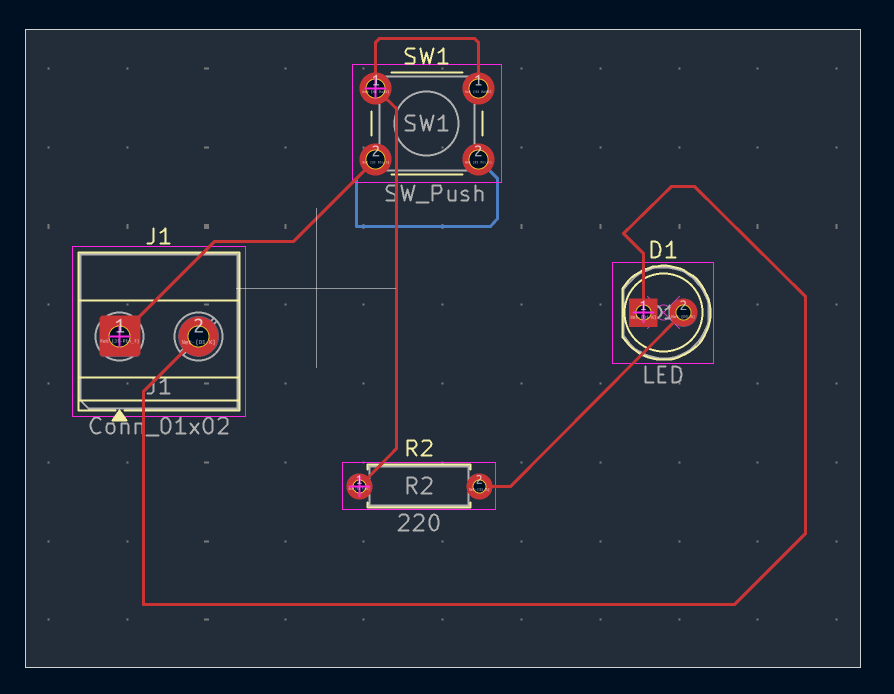
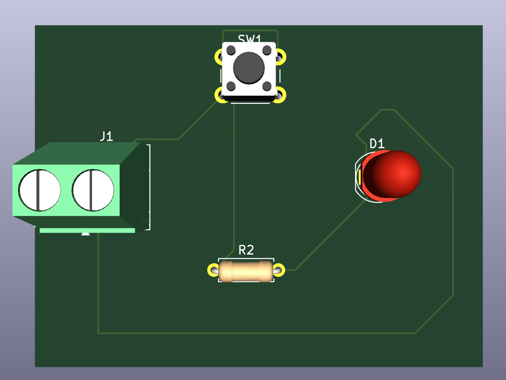

# Push-Button LED PCB Design

**Software:** KiCad
Project Type: Independent Electrical Engineering Project | October 2026

## Project Overview

As an introduction to PCB design, I independently designed a push-button-controlled LED circuit using KiCad. My goal was to gain practical experience with circuit schematics, component placement, and PCB layout.

## Design Process

Created a circuit schematic with a push button, LED, 220 Ω resistor, and two-pin connector.

Translated the schematic into a two-layer PCB layout.

Arranged components and routed traces using KiCad's PCB Editor.

Generated a 3D rendering to visualize the board and its components.

## Project Images

### Circuit Schematic

### PCB Layout

### 3D Rendering

## What I Learned

This project introduced me to the process of translating a circuit schematic into a physical PCB layout. I learned how to use KiCad to create circuit diagrams, assign component footprints, position components, and route electrical connections.

It also helped me better understand how theoretical circuit concepts translate into practical electrical designs.

## Project Status

This project is a digital PCB design. The board has not yet been fabricated or physically tested.
